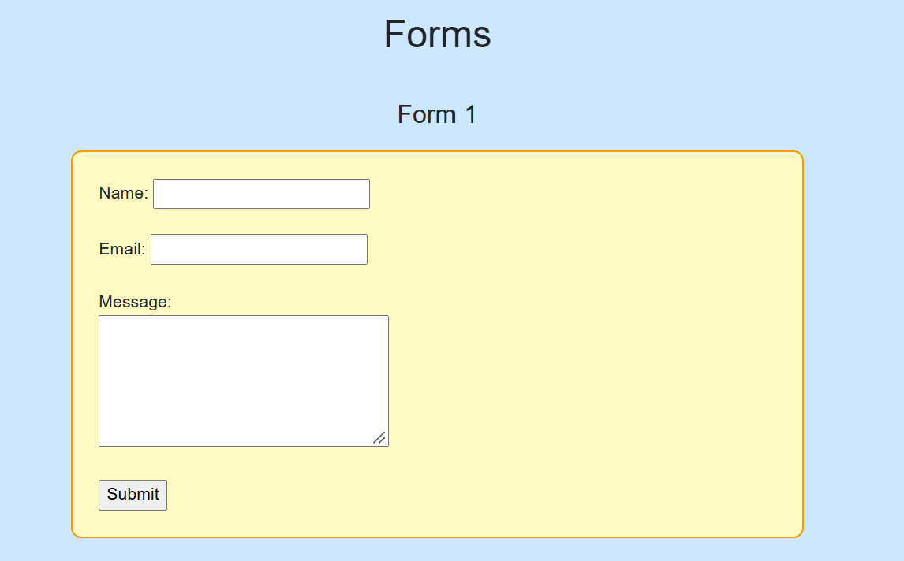
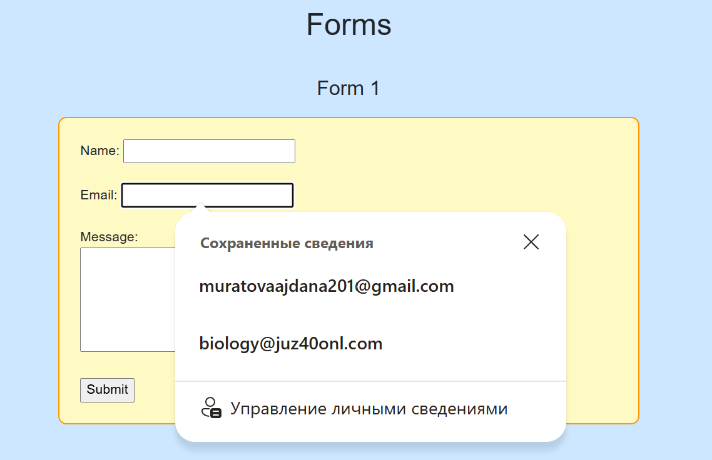
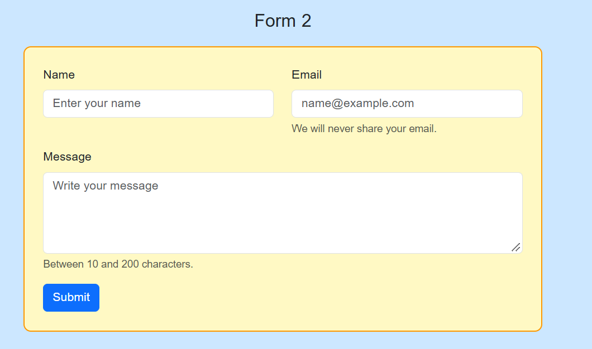
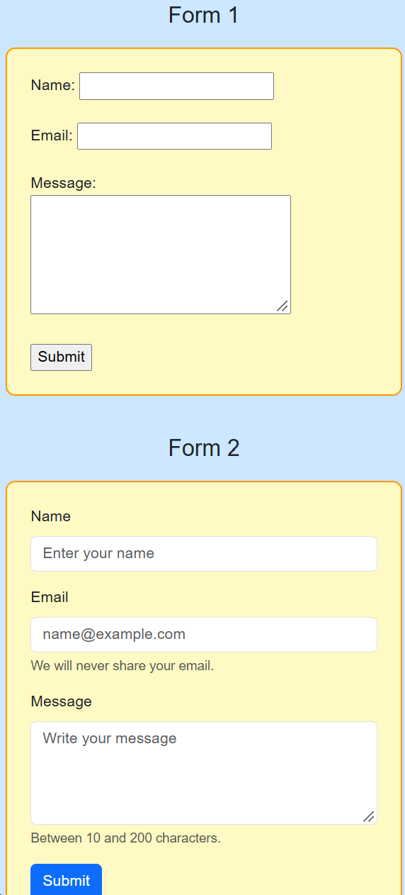
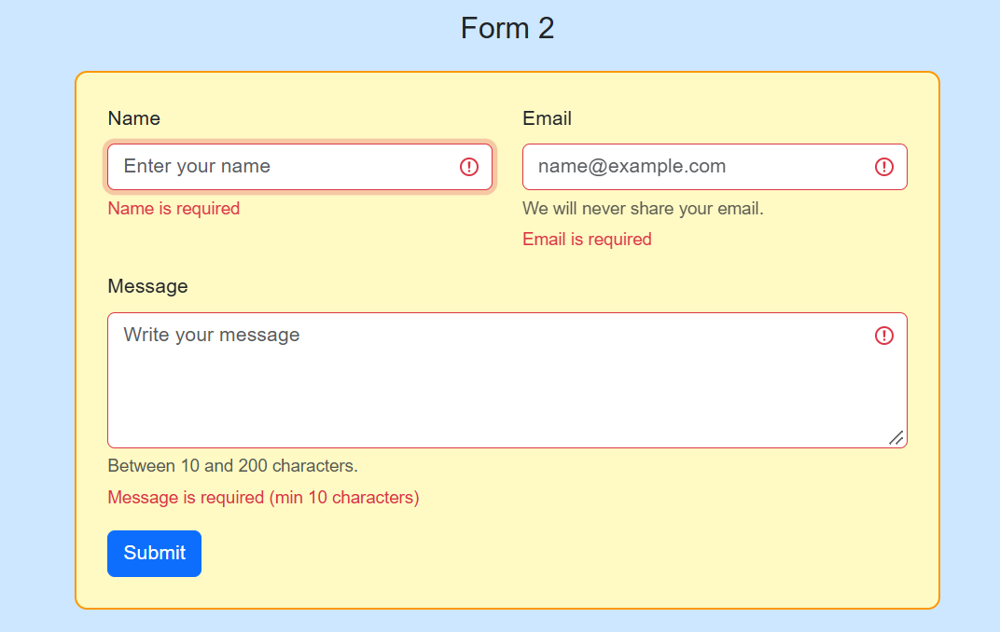
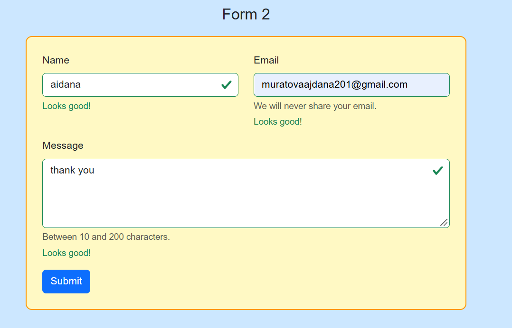
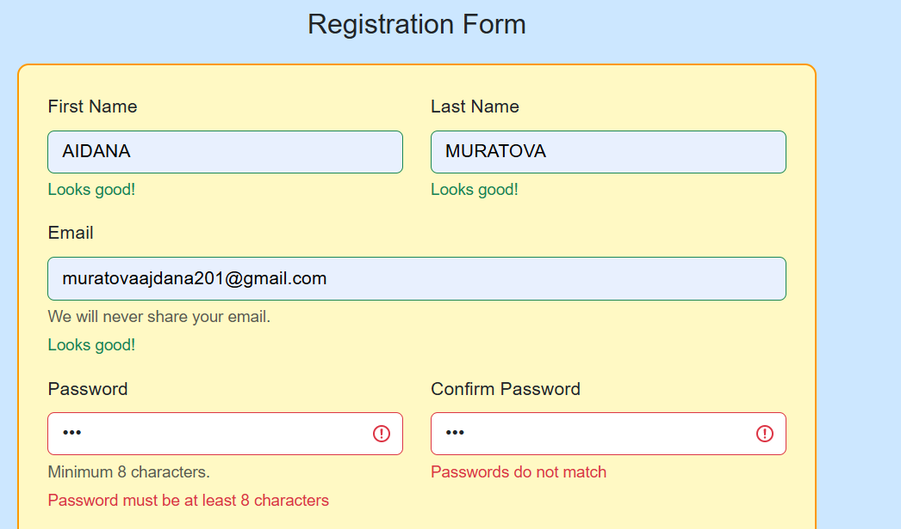
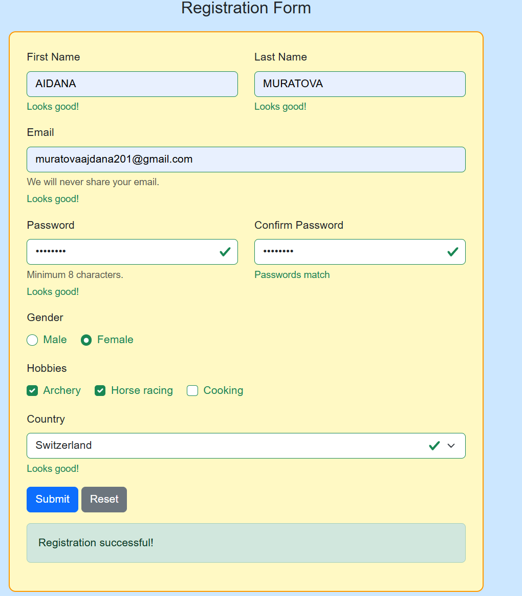
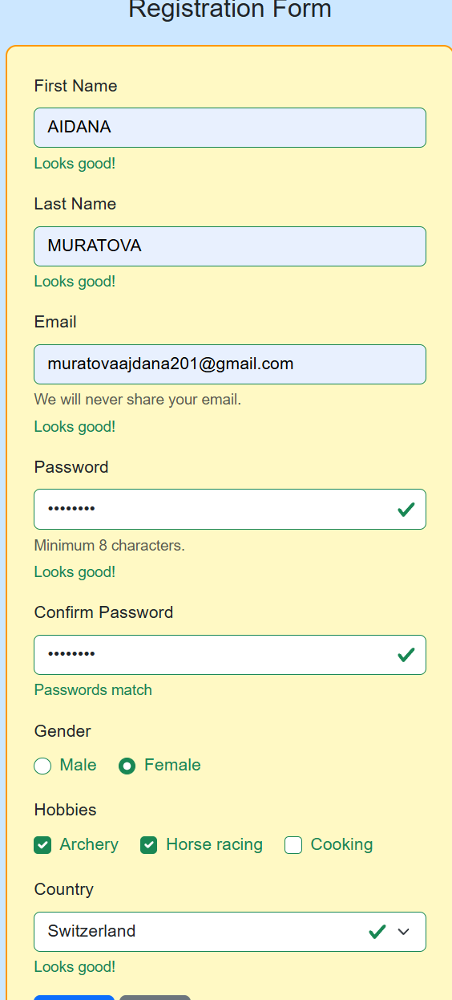

# Assignment 4. Forms and Validation

Name: Aidana Muratova

## Introduction

In this assignment I made three forms on one page, index.html. Form 1 is for Task 0 and Task 1, Form 2 is for Task 2 and Task 3, and Form 3 is the registration form for Task 4. The styles are in style.css and Bootstrap 5 is connected with a CDN link.

For the colors I used a light blue background, yellow boxes for the forms and an orange border.

## Part 1. Basic HTML Forms

### Task 0. Simple Contact Form (Form 1)

I made a simple contact form with Name, Email, Message and a Submit button. Everything is inside the form tag.

Every field has a label. In the label I wrote for="email" and in the input I wrote id="email", they must be the same. Because of this, when I click on the word Email, the cursor goes to the input.

For the name I used type="text", for the email type="email", and for the message a textarea with rows. The button is type="submit".

### Task 1. Form with HTML5 Validation (Form 1)

In this task I added validation attributes to the same Form 1. I used required so the field can't be empty, type="email" so the browser checks the email, and minlength and maxlength for the number of characters. The name must have 2-30 characters and the message 10-200.

I tested it. When I left the field empty, the browser did not send the form and showed a message. When I wrote an email without @, it also showed a message. These messages are made by the browser, so I can't change how they look. The language also depends on the browser.

## Part 2. Bootstrap Forms

### Task 2. Bootstrap Form Styling (Form 2)

In Form 2 I made the contact form again with Bootstrap classes. I used form-label and form-control for the labels and fields, btn btn-primary for the button and mb-3 for the space between the fields.

For the layout I used the grid. Bootstrap has 12 columns in a row. Name and Email are in col-12 col-md-6. On a phone each field takes the full width, so they are one under another. On a bigger screen (from 768px) they are side by side.

I also added placeholders (the gray text inside the empty field) and helper text under the fields with form-text.

### Task 3. Bootstrap Validation Styles (Form 2)

In the same Form 2 I added the validation messages. Under every input there are two divs. valid-feedback shows "Looks good!" and invalid-feedback shows the error, for example "Email is required".

The form has the class needs-validation and the attribute novalidate. With novalidate the browser messages from Task 1 are off, so I see only the Bootstrap style. At first I forgot it and the browser message was shown instead.

A small script works when I press Submit. It checks the form with checkValidity() and adds the class was-validated. After that the correct fields become green and the wrong ones become red with the message.

I tried empty fields, a wrong email and correct data.

## Part 3. Advanced Form Project

### Task 4. Registration Form (Form 3)

Form 3 has First Name, Last Name, Email, Password, Confirm Password, Gender, Hobbies, Country and the buttons Submit and Reset. The names and the passwords are in two columns with col-md-6, so the form is responsive.

The password has required and minlength="8". To check Confirm Password I used JavaScript. The function checkPasswords compares the two passwords. If they are different, setCustomValidity makes the field wrong and it shows "Passwords do not match". If they are the same, I call setCustomValidity with an empty text and the field is correct.

Gender is radio buttons with the same name="gender", so I can choose only one. Hobbies is checkboxes, I can choose many or none, so there is no required. Country is a select, and the first option "Choose..." has an empty value, so required does not let me leave it.

Submit checks the form. If everything is correct, the message "Registration successful!" appears. I used event.preventDefault() because there is no server and the page should not reload. The Reset button clears the form and removes was-validated, so the colors go away.

## Summary

First I made a simple form with labels and inputs. Then I added the HTML5 attributes and tested them. After that I connected Bootstrap and made the form again with the classes and the grid. Then I added the feedback messages and the script. In the end I made the registration form with the other fields and the check for the passwords. I tested all forms with correct and wrong data, on the computer and in the phone mode (F12).

The hardest things for me were novalidate, which I forgot at first, and the password confirmation with setCustomValidity.
## Conclusion

In this assignment I learned how a form works from the basic HTML to a full registration form with validation. The most important thing I understood is that a form is not only fields and a button. A good form must be clear for the user, it must check the data and it must tell the user what is wrong.

I started with Form 1. Here I understood the structure of a form. Everything is inside the form tag, and every field has a label that is connected to the input with for and id. I also learned that different types of inputs give different behavior. For example, type="email" knows that it needs an email, and a textarea is for long text. After this I added the HTML5 attributes required, minlength, maxlength and type="email". I was surprised that the browser can check the data without any JavaScript. But I also saw the problem: the message is made by the browser, so I can't change how it looks, and it can be in a different language.

In Form 2 I used Bootstrap. I understood that Bootstrap is not magic, it is just ready CSS classes, and I need to know what each class does. form-control makes the field wide and nice, form-label is for the label, and mb-3 gives a space. The most important part was the grid. A row has 12 columns, and col-12 col-md-6 means that on a phone the field takes the whole line and from 768px two fields are in one line. Bootstrap is mobile first, so I think about the phone size first and then about the bigger screens. I checked this in F12 in the phone mode and I saw how the fields go one under another.

Then I added the Bootstrap validation to Form 2. Here I understood how the pieces work together. The input has the rules (required, minlength), under it there are valid-feedback and invalid-feedback, and novalidate turns off the browser messages. The script does only one thing: when I press Submit it adds the class was-validated to the form. After this class appears, Bootstrap shows the green or red color and the right message for every field. Without this class the form looks normal. It was interesting for me that the whole logic is in this one class.

The registration form is the biggest one, and here I used everything together. I made the layout with the grid, the HTML5 validation (for example the password has minlength="8") and the Bootstrap messages. I also learned the difference between radio buttons and checkboxes. The radio buttons have the same name, so only one can be chosen, and the checkboxes are independent, so I can choose many or none. For the select, the first option has an empty value, so required does not accept it and the user must choose a real country.

The hardest part was Confirm Password, because HTML5 can't compare two fields. I solved it with setCustomValidity. If the passwords are different, I mark the field as wrong with a text, and if they are the same, I clear it with an empty text. I run this check every time the user types, and also when the form is submitted.

I used event.preventDefault() to stop the page from reloading, because there is no server in this project. Without it the page reloads and the green and red colors disappear. If all the fields are correct, the success message is shown. The Reset button clears the form and I remove was-validated, so the colors go away too. In style.css I made the light blue background, the yellow boxes with the orange border, and I turned off the resizing of the textarea with resize: none.

I also understood that I must test a form with different data: empty fields, a wrong email, a short password, different passwords and a correct case. When I tested, I found the mistakes and fixed them, for example the page was reloading and the green state was not visible.

Now I can make a form with labels, HTML5 validation and Bootstrap, I can make it responsive with the grid, I can show the error and success messages, and I can explain how every part of my code works. It will be useful for the next topics, because the forms and the JavaScript events will be used in the next assignments and in the final project.
